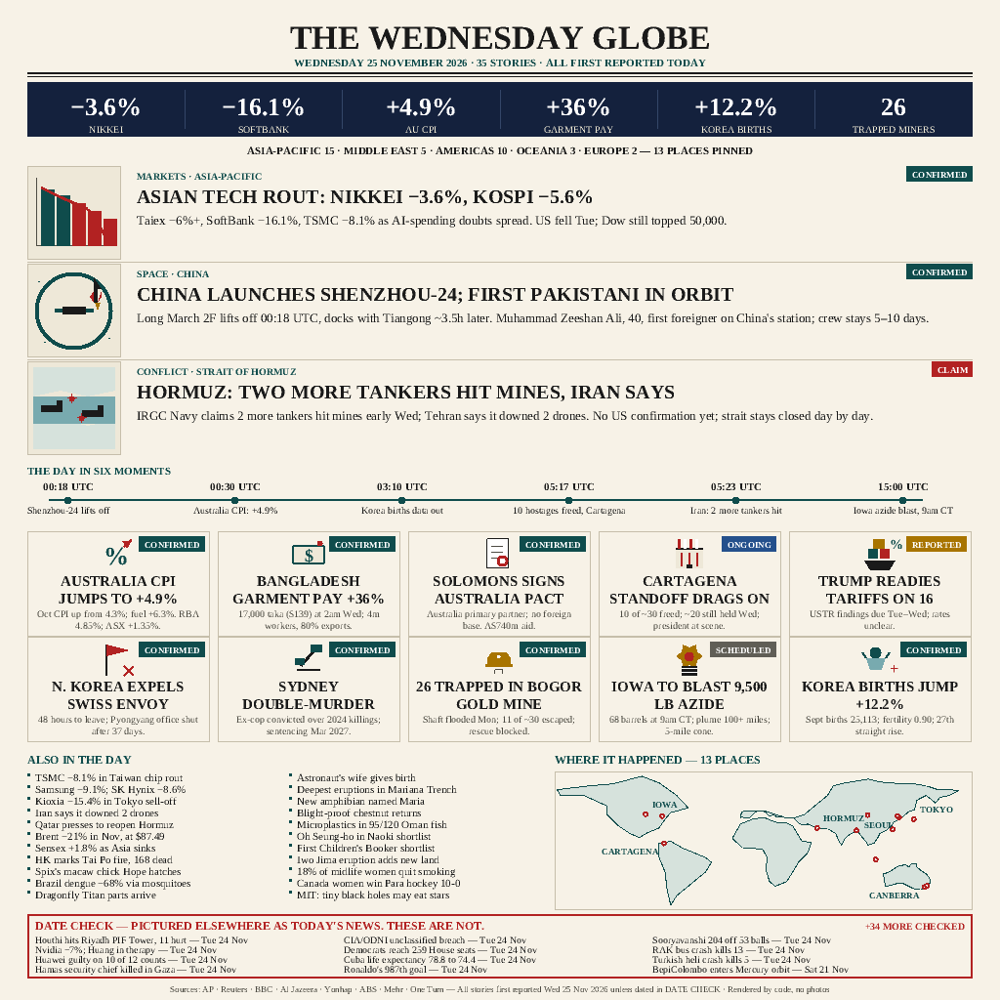

# news-image-20261125 — The Wednesday Globe

[](https://make.fun)
[](https://www.python.org)
[](LICENSE)

Sum up **Wednesday 25 November 2026's world news in one image** — an entry for the
[make.fun](https://make.fun) bounty **news-image-20261125** ($100, free).



## What it is

A single Python program (`main.py`, pure stdlib, no network) that renders a
1024×1024 broadsheet front page — **"The Wednesday Globe"** — from 35 stories
first reported on Wednesday 25 November 2026:

- **3 leads** — Asia's AI tech rout (Nikkei −3.6%, Kospi −5.6%), Shenzhou-24
  carrying the first Pakistani in orbit, and Iran's claim of two more tankers
  hit by mines in the Strait of Hormuz.
- **10 small cards** — Australia CPI +4.9%, Bangladesh garment pay +36%,
  the Solomons–Australia treaty, the Cartagena standoff, Trump tariffs on 16
  economies, North Korea expelling the Swiss envoy, the Sydney double-murder
  verdict, 26 miners trapped in Bogor, Iowa's 9,500 lb lead-azide blast, and
  Korea's births jumping +12.2%.
- **22 also-listed stories**, a 6-moment timeline, a 13-place world map, and a
  **DATE CHECK** box naming 12 stories pictured elsewhere as today's news
  that actually happened on Tuesday 24 November or earlier (Nvidia −7%,
  Huawei's verdict, the Riyadh tower strike, Ronaldo's 987th goal, and more).

Every glyph is drawn from Liberation Serif outlines regenerated in-session
from the system TTFs (`GLYPH_BLOB` in `main.py`); the PNG is encoded by hand.
The render is deterministic — two runs produce byte-identical output.

## Run it

```sh
MAKEFUN_OUTPUT_DIR=/output python3 main.py   # writes /output/entry.png
```

## Story list & sources

Every number on the page was verified live against AP, Reuters, BBC,
Al Jazeera, Yonhap, the ABS, Mehr News, and the One Turn day page for
25 November 2026. The full 46-item date-check list (stories pictured
elsewhere as Wednesday's news that actually happened on Tuesday
24 November or earlier) is documented in the project notes.
